# Hi, I'm Mime 👋

French 🥖 developer, mostly **Java** (Minecraft plugins and mods) and **TypeScript** (React and Next.js websites). In my free time, I'm slowly putting together my own little Minecraft server.

- 🖥️ Portfolio: [mimedev.fr](https://mimedev.fr?utm_source=github.com&utm_medium=readme&utm_content=portfolio)
- ✉️ Contact: [mime@mimedev.fr](mailto:mime@mimedev.fr) · [Discord](https://discord.mimedev.fr)
- 🚀 Currently working on: anything 🙃

### Tech

  

### Numbers

<picture>
  <source media="(prefers-color-scheme: dark)" srcset="https://raw.githubusercontent.com/Mimexe/Mimexe/cards/summary-dark.svg">
  
</picture>
<picture>
  <source media="(prefers-color-scheme: dark)" srcset="https://raw.githubusercontent.com/Mimexe/Mimexe/cards/languages-dark.svg">
  
</picture>

<picture>
  <source media="(prefers-color-scheme: dark)" srcset="https://raw.githubusercontent.com/Mimexe/Mimexe/cards/contributions-dark.svg">
  
</picture>
<picture>
  <source media="(prefers-color-scheme: dark)" srcset="https://raw.githubusercontent.com/Mimexe/Mimexe/cards/weekly-dark.svg">
  
</picture>

  <a href="https://ko-fi.com/mime4x">
    <picture>
      <source media="(prefers-color-scheme: dark)" srcset="https://storage.ko-fi.com/cdn/brandasset/v2/support_me_on_kofi_badge_beige.png">
      
    </picture>
  </a>

